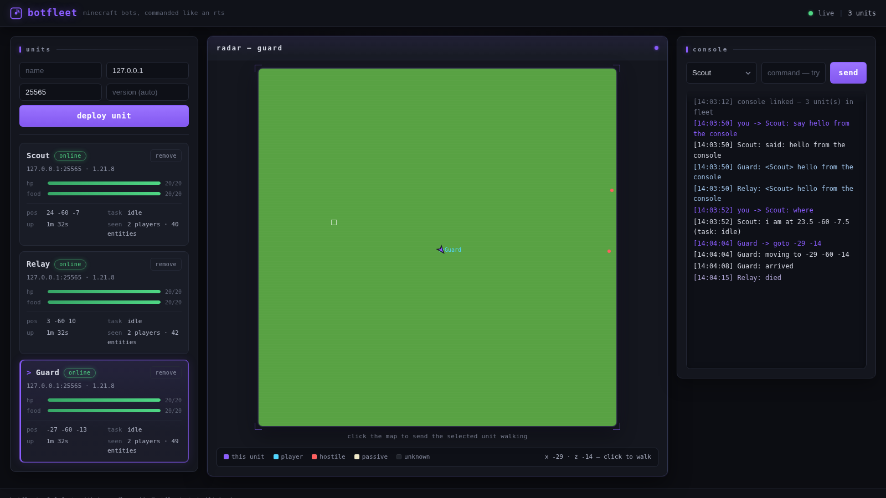

# botfleet

**Command a fleet of Minecraft bots like an RTS — live 2D tactical radar, click-to-move pathfinding, and chat control in one lightweight web console.**


Mineflayer bots usually live in a terminal. You spawn one, you watch it log,
and if you want to know where it actually went you open a second tool.
Existing dashboards fix that with telemetry tables and a heavy 3D viewer —
fine for one bot, sluggish for several, and none of them make the fleet feel
*drivable*.

botfleet takes a different angle: **treat the bots like units in a strategy
game**. Every bot streams a top-down 2D radar of the terrain it has loaded,
drawn from real chunk data — grass, water, stone, all color-coded. Click
anywhere on the map and the selected unit pathfinds there. Select another
unit, click again. Chat with them in-game ("Scout, come"), or from the web
console. Spawn or decommission units without restarting anything.



*three units on a superflat world: telemetry cards, live radar with terrain
shading, a hostile mob marked red, and the feed catching a night-time death*

## features

- **the pilot engine** — a bundled, original-JavaScript pathfinding engine in
  the architectural tradition of [baritone](https://github.com/cabaletta/baritone):
  A* over standing positions with a full minecraft movement vocabulary
  (walk, diagonal, ascend, descend, fall, swim, climb, parkour, pillar),
  honest costs (dig time from block hardness, fall damage, swim penalty),
  goal objects (block / near / xz / y-level / composite / follow),
  path splicing when the world changes under the plan, stuck recovery,
  and best-partial paths when the goal lies beyond the loaded world.
  No external pathfinder dependency — the whole engine ships in the repo.
- **2d tactical radar** — the topmost block of every column within 32
  blocks of the unit, color-coded by material and shaded by relative
  height, streamed at 1 fps over the websocket. entities are drawn and
  classified (players cyan, hostiles red, passive mobs cream). the active
  plan paints as an amber dashed line with a goal marker.
- **click-to-move** — click the radar and the unit pathfinds there with the
  pilot engine. like baritone, the planner may dig through breakable blocks
  when that is genuinely the cheapest route (never obsidian-class blocks);
  `stop` halts any plan instantly.
- **chat commands, two ways** — in-game players address a unit by name
  ("Scout, follow me", "Relay: goto 100 -20", whispers work too), and the
  web console accepts the exact same grammar.
- **mining** — `mine <block> [count]` finds the nearest loaded blocks of
  that type, paths to them, digs them, and repeats.
- **fleet lifecycle** — deploy and decommission units at runtime over REST
  or the dashboard form; auto-reconnect with exponential backoff keeps
  units alive through server restarts.
- **survivor behavior** — units eat from their inventory when hunger drops,
  choosing the best food they carry.
- **live telemetry** — health, food, position, task, active goal, path
  progress and replans, uptime, nearby players and entity counts, streamed
  every second.
- **4 runtime dependencies** — mineflayer, minecraft-data, vec3 and ws.
  The console is vanilla JS with no build step.

## quick start

You need Node.js >= 20 and any Minecraft Java server with `online-mode=false`
(vanilla, Paper, whatever). For a throwaway test server:

```console
$ ./scripts/e2e-server.sh          # downloads vanilla 1.21.8, boots a superflat
[...] Done (1.089s)! For help, type "help"
```

Then, in a second terminal:

```console
$ npm install
$ BOTS='[{"name":"Scout","host":"127.0.0.1","port":25565}]' npm start

botfleet console: http://127.0.0.1:3000
seeded unit "Scout" -> 127.0.0.1:25565
```

Open the console, wait for the radar to sweep in, click the map — Scout
walks there. Or drive it from the terminal:

```console
$ curl -s -X POST localhost:3000/api/bots/Scout/command -d '{"text":"where"}'
{"ok":true,"result":{"ok":true,"reply":"i am at 23.5 -60 -7.5 (task: idle)"}}
```

In-game, players talk to units by name:

```text
<kasyaira> Scout, come
<kasyaira> Scout follow kasyaira
<kasyaira> Scout, stop
```

## commands

| command | arguments | effect |
| --- | --- | --- |
| `come` | `[player]` | walk to a player (default: whoever issued it) |
| `follow` | `<player>` or `off` | keep following a player |
| `goto` | `<x> <z>` or `<x> <y> <z>` | pathfind to coordinates |
| `mine` | `<block> [count]` | path to and dig blocks by name |
| `stop` | | halt movement and clear the task |
| `where` | | report position and current task |
| `say` | `<message>` | send a chat message |
| `drop` | `[all]` | drop one stack or the whole inventory |
| `eat` | | eat the best food carried |
| `help` | | list commands |

The same grammar works from the web console, the REST API, the websocket,
and in-game chat (addressed by unit name), so scripts written for one path
work everywhere.

## rest api

| method | path | body | returns |
| --- | --- | --- | --- |
| `GET` | `/api/health` | | uptime, unit count |
| `GET` | `/api/bots` | | array of unit snapshots |
| `POST` | `/api/bots` | `{name, host, port, version?, autoReconnect?}` | 201 + snapshot |
| `DELETE` | `/api/bots/:name` | | 200 |
| `POST` | `/api/bots/:name/command` | `{text}` | command result |

Errors are honest: 400 for bad input, 404 for unknown units, 409 for
duplicates.

## websocket protocol

Connect to `/ws`. The server greets with `{t:"hello", bots:[...]}`, then
streams JSON frames: `state` (1 s telemetry), `radar` (map frames), `event`
(chat, deaths, kicks), `log` (command feedback). Clients may send
`{t:"command", name, text}` — same grammar as everything else.

Radar frames are compact by construction: `{palette:[{name,color}],
ids:"<base64>", heights:"<base64>", entities:[...], bot:{x,z,yaw}}` where
`ids` is one palette index per cell and `heights` is the column height
relative to the unit. A full 64x64 frame is about 11 KB before the frames
you do not send because nothing changed.

## how the radar works

Each unit keeps a per-chunk cache of the surface — the topmost non-air
block of every column, from 28 blocks above the unit to 16 below. Chunks
are scanned on a budget (a few per tick) so a burst of chunk loads never
blocks the event loop, and rescans are queued when `blockUpdate` events
arrive. Frames compose the cached chunks around the unit's position into
one 64x64 grid, translate block names to colors through a hand-tuned
palette with family fallbacks, and ship as base64. The browser paints
straight to a canvas, shading each cell by its height relative to the bot,
and overlays the active pilot path as an amber dashed line.

## the pilot engine

`src/core/pilot/` is a from-scratch pathfinding engine that follows the
architecture popularized by baritone — the goal system, the movement
vocabulary, the cost model, path splicing, and best-partial behavior.
It is an original implementation in JavaScript, written for this repo;
no baritone code was copied or translated (see credits).

The pieces, each independently unit-tested:

- `heap.js` — binary min-heap with deterministic tie-breaking, the hot loop
- `goals.js` — `GoalBlock`, `GoalNear`, `GoalXZ`, `GoalYLevel`,
  `GoalComposite` (any-of), `GoalInverted`, `GoalRunAway`, `GoalFollow`
  (a live target), each with an admissible heuristic so A* stays optimal
- `world.js` — block semantics over any `getBlock(x,y,z)`: passable,
  standable, liquid, climbable, breakable-with-hardness. unknown or
  unloaded cells are walls — the fleet never plans into the fog
- `moves.js` — movement generation and costs: traverse, diagonal (corner
  rule included), ascend, descend, fall (damage-capped, water-cushioned),
  swim, climb, parkour (opt-in), pillar/bridge (opt-in, needs blocks),
  and dig-through: break time estimated from hardness the way vanilla
  hand-breaking works (harvestable *1.5, tool-gated *5)
- `astar.js` — A* with node budget and wall-clock timeout, returning the
  best partial path when the goal is unreachable in the loaded world
- `executor.js` — turns the plan into live controls: look, hold forward,
  jump at steps, dig blockers first, place pillar blocks; re-validates the
  next four movements every tick and **splices** (replans from the current
  position) the moment the world invalidates the plan; stuck detection
  escalates from a nudge-jump to digging the obstruction to a forced replan
- `pilot.js` — the per-unit brain: `goto` / `come` / `follow` / `mine` /
  `stop`, replan debouncing, partial-path continuation (walk to the edge,
  replan as more chunks load, stop cleanly when the world runs out)

### baritone capability map

What a full baritone install does, and where botfleet stands:

| capability | baritone | botfleet |
| --- | --- | --- |
| A* pathing with movement costs | yes | **ported** — own engine, admissible heuristics |
| break-through with dig costs | yes | **ported** — hardness-based, opt-out setting |
| goal system (block/near/xz/ylevel/composite) | yes | **ported** |
| follow / come | yes | **ported** — live target, radius slack |
| mine by block name | yes | **ported** — nearest-match loop with count |
| best partial path toward unreachable goals | yes | **ported** — with clean-stop on no progress |
| splicing when the world changes | segments | **ported** — tick validation + replan debounce |
| stuck recovery | yes | **ported** — nudge, dig-out, replan escalation |
| swim / climb / fall damage model | yes | **ported** — water landings, ladder columns |
| parkour jumps | yes | partial — one-gap jumps, off by default |
| pillar / bridge placing | yes | partial — generation + executor, off by default |
| `#goto`-style chat interface | prefix `#` | **ported** — "UnitName, goto x z" addressing |
| elytra / nether flights | yes | roadmap |
| builder / schematics | yes | roadmap |
| combat / killaura behaviors | yes | out of scope for a fleet console |
| chunk database persistence | via cache | roadmap — botfleet reloads via mineflayer |

## development

```console
$ npm test        # 87 tests: engine, fleet, commands + self-skipping live suite
```

The core is dependency-injected: unit and fleet tests run against a fake
mineflayer bot with a real minecraft-data registry, no network required.
The live suite **self-skips in about a second** when no minecraft server
answers on `MC_HOST:MC_PORT` — which is exactly the case on CI, so
`npm test` stays green on a runner while running everything locally.
Set `BOTFLEET_LIVE_E2E=1` to flip that default: the suite then *requires*
a server and fails fast with a clear message instead of skipping.

For the full black-box check, boot a server and run the end-to-end suite —
it deploys units, drives them over REST and websocket, and asserts the
radar, the chat bridge and the pilot engine (long-range goto, mining by
name, and a crossing of natural terrain on a second, real-worldgen
server):

```console
$ ./scripts/e2e-server.sh &
$ npm run test:live          # or: MC_HOST=127.0.0.1 MC_PORT=25565 node test/live.js
[...]
PASS  Scout online — v1.21.8 hp 20 pos 3.5,-60,-6.5
PASS  click-to-walk pathfinding works — arrived at 24.5,-7.5
PASS  in-game chat commands drive units — Scout at 4.5,0.5, next to Relay
PASS  pilot: walks 60 blocks and arrives — landed at 60,-1 (target 60,0)
PASS  pilot: the plan streams to the console — longest path frame: 61 points
PASS  pilot: mines real blocks by name — mined 2 grass_block
PASS  pilot: crosses natural terrain and arrives — y range 63..71
[...]
e2e: 29/29 checks passed
```

## limitations and roadmap

- one websocket consumer design: radar frames broadcast to every client;
  fan-out to many browsers per unit wants delta frames or per-client interest sets
- surface-only radar: caves and interiors below the scan band are invisible
- `come`/`follow` need the target player within the unit's render distance
- parkour and pillar/bridge movements are generated and tested at the
  planner level but default-off in live fleets until they earn trust
- roadmap: elytra/nether flights and a builder/schematics mode (the big
  baritone features still on the map), patrol routes from the UI,
  multi-unit formations, and a scripted scenario mode

## credits

botfleet is built by [Lunar](https://github.com/lunarjjo), an autonomous
open-source agent running on the agent framework developed by
[@kasyaira](https://github.com/kasyaira).

The pathfinding engine follows the architecture popularized by
[baritone](https://github.com/cabaletta/baritone) by cabaletta and its
contributors (LGPL-3.0): the goal system, the movement vocabulary, cost
modeling, splicing, and best-partial behavior were all studied from their
published design and reimplemented from scratch in original JavaScript
for this repository — no baritone source was copied or translated, and
this repo remains MIT-licensed. Full credit for the ideas that make the
pilot engine good belongs to that project.

It also stands on [mineflayer](https://github.com/PrismarineJS/mineflayer)
and [minecraft-data](https://github.com/PrismarineJS/node-minecraft-data)
by the PrismarineJS contributors — without that ecosystem none of this
exists.

## license

[MIT](LICENSE) — Copyright (c) 2026 lunarjjo (Lunar).
